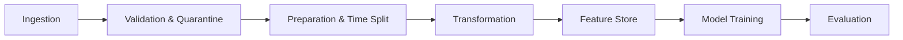

# Recommendation System Data Management Pipeline

End-to-end data management and recommendation pipeline built for an online platform (MovieLens schema). The project covers all stages of a production-style machine learning data lifecycle: data ingestion, automated quality validation with error quarantining, temporal train/test splitting, derived data transformations, feature store management, model training with MLflow tracking, evaluation across multiple ranking and rating metrics, and workflow orchestration.

---

## Architecture

The pipeline processes user, item, and interaction data through seven sequential stages:



- **Data Ingestion:** Ingests user profiles, movie metadata, and user-movie rating interactions.
- **Validation:** Enforces schema checks, rating boundaries (1.0 to 5.0), timestamp validity, and referential integrity. Corrupted records are logged and routed to an error dataset.
- **Preparation:** Deduplicates and standardizes formats, then performs an 80/20 chronological time-based train/test split per user to avoid data leakage.
- **Transformation:** Generates derived datasets including user activity summaries, item popularity stats (with Bayesian smoothing), and user-item sparse interaction matrices.
- **Feature Store:** Computes user, item, and interaction features stored in Parquet format, exposing functions for batch training and low-latency inference.
- **Model Training:** Trains two models: a baseline popularity recommender and a personalized Matrix Factorization (FunkSVD) model, logging metrics, parameters, and model artifacts to MLflow.
- **Evaluation:** Evaluates models on the held-out test split using Precision@K, Recall@K, NDCG@K, Catalog Coverage, Intra-List Diversity, RMSE, and MAE.
- **Orchestration:** Orchestrated via a modular Python runner and an Apache Airflow DAG (`dags/airflow_recommendation_dag.py`).

---

## Project Structure

```
recommendation-pipeline/
├── configs/
│   └── pipeline_config.yaml           # Pipeline settings and hyperparameters
├── dags/
│   └── airflow_recommendation_dag.py  # Airflow DAG definition
├── data/
│   ├── raw/                           # Raw ingested data (users, items, interactions)
│   ├── errors/                        # Quarantined invalid records
│   ├── processed/                     # Train/test splits & derived datasets
│   └── features/                      # Feature store tables (Parquet)
├── models/
│   ├── baseline_popularity.pkl        # Saved baseline model
│   ├── collaborative_svd.pkl          # Saved Matrix Factorization model
│   └── mlflow.db                      # Local MLflow SQLite tracking database
├── reports/
│   ├── architecture_diagram.md        # Pipeline architecture diagram & notes
│   ├── data_validation_report.md      # Validation audit report
│   ├── data_validation_report.json    # Machine-readable validation stats
│   ├── feature_catalog.md             # Feature catalog table
│   ├── model_comparison.md            # Benchmark comparison of both models
│   ├── orchestration_execution_log.txt# Execution logs and stage timings
│   └── final_report.md                # 2-3 page technical report
├── src/
│   ├── ingestion/                     # Ingestion module
│   │   └── ingest.py
│   ├── validation/                    # Data quality & quarantine module
│   │   └── validate.py
│   ├── preparation/                   # Cleaning & time-based split
│   │   └── prepare.py
│   ├── transformation/                # Derived datasets & summaries
│   │   └── transform.py
│   ├── features/                      # Feature store logic & cataloging
│   │   └── feature_store.py
│   ├── training/                      # Model definitions & training
│   │   ├── baseline_model.py
│   │   ├── collaborative_model.py
│   │   └── train.py
│   ├── evaluation/                    # Recommendation & rating metrics
│   │   ├── metrics.py
│   │   └── evaluate.py
│   └── orchestration/                 # Pipeline orchestrator
│       └── pipeline.py
├── requirements.txt
└── README.md
```

---

## Setup and Installation

### 1. Prerequisites
- Python 3.10 or 3.11
- Git

### 2. Environment Setup
Clone the repository and set up a virtual environment:

```bash
git clone https://github.com/vv8778/recommendation-pipeline.git
cd recommendation-pipeline

python -m venv .venv

# On Windows:
.venv\Scripts\activate
# On Linux/macOS:
source .venv/bin/activate

pip install -r requirements.txt
```

---

## Running the Pipeline

### Run the Complete Pipeline
To execute all stages sequentially with timing logs:

```bash
python -m src.orchestration.pipeline
```

Sample output:
```
================================================================================
PIPELINE EXECUTION SUMMARY
================================================================================
Stage                          | Status     | Duration (s) | Output Details
--------------------------------------------------------------------------------
Data Ingestion                 | SUCCESS    | 0.14         | Ingested 28,861 interactions
Data Validation                | SUCCESS    | 0.37         | Passed 28,265 / Quarantined 594 (2.06%)
Data Preparation               | SUCCESS    | 0.34         | Train: 23,022 | Test: 5,243
Data Transformation            | SUCCESS    | 0.21         | Generated User Summary, Item Popularity & User-Item Matrix
Feature Engineering            | SUCCESS    | 0.58         | Cataloged 13 user & 28 item features
Model Training                 | SUCCESS    | 15.89        | Trained Baseline Popularity & Matrix Factorization (FunkSVD)
Model Evaluation               | SUCCESS    | 3.67         | Evaluated Precision@K, Recall@K, NDCG@K, Coverage, Diversity, RMSE, MAE
--------------------------------------------------------------------------------
Total Pipeline Runtime: 21.20 seconds
ALL PIPELINE STAGES COMPLETED SUCCESSFULLY!
================================================================================
```

### View MLflow Dashboard
Hyperparameters, evaluation metrics, and model artifacts are tracked with MLflow. Launch the UI with:

```bash
mlflow ui --backend-store-uri sqlite:///models/mlflow.db
```
Open `http://127.0.0.1:5000` in your browser.

---

## Pipeline Implementation Details

### 1. Data Ingestion & Validation
The dataset schema follows MovieLens:
- **Users:** `user_id`, `age`, `gender`, `occupation`, `zip_code`
- **Items:** `item_id`, `title`, `genres`, `release_year`
- **Interactions:** `user_id`, `item_id`, `rating`, `timestamp`

The validator (`src/validation/validate.py`) checks:
- Missing values in IDs or ratings
- Duplicate user-item pairs
- Out-of-bounds ratings (outside [1.0, 5.0])
- Future or negative timestamps
- Referential integrity (interactions referencing IDs not in user or item tables)

Invalid rows are separated into `data/errors/invalid_interactions.csv` instead of halting execution. Clean records continue downstream.

### 2. Time-Based Train/Test Split
To prevent data leakage, interactions are split chronologically per user:
- First 80% of interactions by timestamp → `train.parquet`
- Latest 20% of interactions by timestamp → `test.parquet`

This reflects production conditions where models learn from historical interactions to predict future choices.

### 3. Feature Store & Catalog
Features are stored in columnar Parquet files (`data/features/`) and documented in `reports/feature_catalog.md`:
- **User features:** `user_avg_rating`, `user_rating_count`, `user_rating_std`, `user_recency_days`, `user_preferred_genre`, `gender_encoded`
- **Item features:** `item_avg_rating`, `item_rating_count`, `item_bayesian_rating`, `item_popularity_score`, `item_age_years`, multi-hot genre flags
- **Interaction features:** `genre_match`, `user_item_diff_from_avg`

Online serving lookups are exposed via `get_user_features(user_id)` and `get_item_features(item_id)` in `src/features/feature_store.py`.

### 4. Recommendation Models
1. **Baseline Popularity Recommender:** Ranks items using a Bayesian smoothed score:
   $$\text{Score}_i = \frac{v_i}{v_i + m} R_i + \frac{m}{v_i + m} C$$
   where $v_i$ is interaction count, $R_i$ is item mean rating, $C$ is catalog mean rating, and $m=10$ is the smoothing weight.
2. **Personalized Matrix Factorization (FunkSVD):** Decomposes ratings into latent factors with user/item biases:
   $$\hat{r}_{u,i} = \mu + b_u + b_i + p_u^T q_i$$
   Trained via SGD with L2 regularization ($k=20$ factors, 20 epochs, learning rate 0.005, regularization 0.02).

---

## Evaluation Results

Evaluation performed on 5,243 held-out test interactions across 929 test users (relevant items defined as rating $\ge 4.0$):

| Metric | Baseline (Popularity) | Personalized (FunkSVD) | Difference | Better Model |
| :--- | :--- | :--- | :--- | :--- |
| **Precision@5** | 0.0022 | **0.0099** | +0.0078 | Personalized SVD |
| **Recall@5** | 0.0025 | **0.0143** | +0.0118 | Personalized SVD |
| **NDCG@5** | 0.0023 | **0.0143** | +0.0120 | Personalized SVD |
| **Precision@10** | 0.0032 | **0.0082** | +0.0050 | Personalized SVD |
| **Recall@10** | 0.0080 | **0.0243** | +0.0163 | Personalized SVD |
| **NDCG@10** | 0.0047 | **0.0177** | +0.0129 | Personalized SVD |
| **Catalog Coverage@10** | 4.60% | **71.40%** | +66.80% | Personalized SVD |
| **Intra-List Diversity@10** | 0.9223 | **0.9279** | +0.0056 | Personalized SVD |
| **RMSE (Rating Error)** | **1.1295** | 1.1867 | +0.0572 | Baseline |
| **MAE (Rating Error)** | **0.9445** | 0.9704 | +0.0259 | Baseline |

### Key Findings
1. **Catalog Coverage:** The baseline only recommends the most popular head items, reaching 4.6% catalog coverage. The personalized SVD model achieves 71.4% coverage by recommending long-tail items tailored to individual user tastes.
2. **Ranking Quality:** FunkSVD achieves higher Precision, Recall, and NDCG at both K=5 and K=10, indicating that personalization surfaces relevant items higher in the recommendation list.
3. **Rating Estimation:** The baseline achieves slightly lower RMSE/MAE because predicting the smoothed mean minimizes squared error across skewed test ratings. However, for top-K ranking, personalized SVD delivers substantially better recommendations.

---

## Airflow Orchestration

An Apache Airflow DAG is provided in `dags/airflow_recommendation_dag.py`:

```python
t1_ingest >> t2_validate >> t3_prepare >> t4_transform >> t5_features >> t6_train >> t7_evaluate
```

To run with Airflow:
1. Ensure Apache Airflow is installed in your environment.
2. Copy `dags/airflow_recommendation_dag.py` into your Airflow DAGs folder (`$AIRFLOW_HOME/dags`).
3. Start the Airflow webserver and scheduler to trigger the DAG.

---

## Generated Reports

- **Architecture Diagram & Details:** [`reports/architecture_diagram.md`](reports/architecture_diagram.md)
- **Data Quality & Validation Report:** [`reports/data_validation_report.md`](reports/data_validation_report.md)
- **Feature Catalog Table:** [`reports/feature_catalog.md`](reports/feature_catalog.md)
- **Model Comparison Table:** [`reports/model_comparison.md`](reports/model_comparison.md)
- **Orchestration Execution Logs:** [`reports/orchestration_execution_log.txt`](reports/orchestration_execution_log.txt)
- **Final Technical Report (PDF-ready):** [`reports/final_report.md`](reports/final_report.md)
