# Architecture Diagram: End-to-End Recommendation Data Management Pipeline

This document illustrates the end-to-end architecture, data flows, and stage dependencies of the Recommendation System Data Management Pipeline.

```mermaid
flowchart TD
    subgraph S1["1. Data Ingestion Stage"]
        RAW_SRC[("Data Sources<br/>(MovieLens / E-Commerce)")] --> INGEST_PROC["Data Ingestor<br/>(Deterministic Stream/Batch)"]
        INGEST_PROC --> RAW_USERS["data/raw/users.csv"]
        INGEST_PROC --> RAW_ITEMS["data/raw/items.csv"]
        INGEST_PROC --> RAW_INTER["data/raw/interactions.csv"]
    end

    subgraph S2["2. Data Validation & Quality Gate"]
        RAW_USERS & RAW_ITEMS & RAW_INTER --> VAL_ENGINE{"Data Validator<br/>(Schema, Types, Boundaries,<br/>Referential Integrity)"}
        VAL_ENGINE -- "Corrupted / Orphaned Records" --> ERRORS[/"data/errors/<br/>invalid_interactions.csv<br/>invalid_users.csv"/]
        VAL_ENGINE -- "Audit Trail" --> VAL_REP[/"reports/<br/>data_validation_report.md"/]
        VAL_ENGINE -- "Clean Data" --> CLEAN_DATA[("Validated Clean Data Pool")]
    end

    subgraph S3["3. Data Preparation & Temporal Split"]
        CLEAN_DATA --> PREP_ENGINE["Data Preparator<br/>(Formatting, Normalization,<br/>Chronological 80/20 Split)"]
        PREP_ENGINE --> TRAIN_DATA["data/processed/train.parquet"]
        PREP_ENGINE --> TEST_DATA["data/processed/test.parquet"]
        PREP_ENGINE --> CLEAN_META["data/processed/<br/>users_clean.parquet<br/>items_clean.parquet"]
    end

    subgraph S4["4. Data Transformation"]
        TRAIN_DATA & CLEAN_META --> TRANS_ENGINE["Data Transformer<br/>(Aggregation & Summarization)"]
        TRANS_ENGINE --> USER_SUMM["data/processed/user_activity_summary.parquet"]
        TRANS_ENGINE --> ITEM_SUMM["data/processed/item_popularity_summary.parquet"]
        TRANS_ENGINE --> INTER_MAT["data/processed/user_item_matrix.parquet"]
    end

    subgraph S5["5. Feature Store Layer"]
        TRAIN_DATA & CLEAN_META --> FEAT_ENGINE["Feature Store Builder<br/>(Windowing, Bayesian Priors, Multi-Hot)"]
        FEAT_ENGINE --> USER_FEAT["data/features/user_features.parquet"]
        FEAT_ENGINE --> ITEM_FEAT["data/features/item_features.parquet"]
        FEAT_ENGINE --> INTER_FEAT["data/features/training_interaction_features.parquet"]
        FEAT_ENGINE --> FEAT_CAT[/"reports/feature_catalog.md"/]
    end

    subgraph S6["6. Model Training & MLflow Tracking"]
        TRAIN_DATA & USER_FEAT & ITEM_FEAT --> TRAIN_ENGINE["Model Trainer"]
        TRAIN_ENGINE --> MODEL_BASE["Baseline Popularity<br/>(Bayesian Weighted Ranker)"]
        TRAIN_ENGINE --> MODEL_SVD["Personalized SVD<br/>(20 Latent Factor FunkSVD)"]
        TRAIN_ENGINE --> MLFLOW[("MLflow Tracking<br/>Params, Metrics, Artifacts")]
        MODEL_BASE & MODEL_SVD --> MODEL_STORE[/"models/*.pkl"/]
    end

    subgraph S7["7. Evaluation & Benchmarking"]
        TEST_DATA & MODEL_STORE --> EVAL_ENGINE["Model Evaluator"]
        EVAL_ENGINE --> EVAL_METRICS["Metrics Calculation:<br/>Precision@K, Recall@K, NDCG@K,<br/>Catalog Coverage, Diversity, RMSE, MAE"]
        EVAL_METRICS --> COMP_REP[/"reports/model_comparison.md"/]
        EVAL_METRICS --> MLFLOW
    end

    subgraph S8["8. Workflow Orchestration"]
        ORCH["Airflow DAG / Scheduled Pipeline Runner<br/>(src/orchestration/pipeline.py)"]
        ORCH -. "Coordinates & Monitored by" .-> S1
        ORCH -.-> S2
        ORCH -.-> S3
        ORCH -.-> S4
        ORCH -.-> S5
        ORCH -.-> S6
        ORCH -.-> S7
    end

    style S1 fill:#EBF5FB,stroke:#2980B9,stroke-width:2px
    style S2 fill:#FDEDEC,stroke:#C0392B,stroke-width:2px
    style S3 fill:#FEF9E7,stroke:#F39C12,stroke-width:2px
    style S4 fill:#E8F8F5,stroke:#16A085,stroke-width:2px
    style S5 fill:#F4ECF7,stroke:#8E44AD,stroke-width:2px
    style S6 fill:#EAF2F8,stroke:#3498DB,stroke-width:2px
    style S7 fill:#EAFAF1,stroke:#27AE60,stroke-width:2px
    style S8 fill:#F5EEF8,stroke:#5B2C6F,stroke-width:2px,stroke-dasharray: 5 5
```

---

## Component Descriptions & Architectural Highlights

1. **Decoupled Data Lake Storage Hierarchy (`data/`):**
   - `raw/`: Immutable source records.
   - `errors/`: Quarantined anomaly records preventing pipeline failures and silent training bias.
   - `processed/`: Formatted, normalized, and chronologically split train/test partitions.
   - `features/`: Production-ready columnar feature tables for zero-leakage training and low-latency inference.
2. **Quality Gate (`src/validation/`):**
   - Automated boundary checking ($1.0 \le \text{rating} \le 5.0$), timestamp sanity ($\text{ts} \le \text{current\_time}$), null checking, deduplication, and referential integrity between interactions and entities.
3. **Temporal Splitting Strategy:**
   - Strict chronological per-user 80/20 train/test split preventing future interaction data from leaking into the training set.
4. **Feature Management (`src/features/`):**
   - Online/Offline feature reuse pattern providing feature vector lookup for inference (`get_user_features`, `get_item_features`) and unified tabular features for training.
5. **Experiment Tracking (`MLflow`):**
   - Automatically tracks model runs, hyperparameter sweeps, metric evolutions, and model binary serialization.
6. **Unified Orchestration (`dags/` & `src/orchestration/`):**
   - Supports both standalone lightweight execution (`python -m src.orchestration.pipeline`) and enterprise DAG deployment via Apache Airflow.
